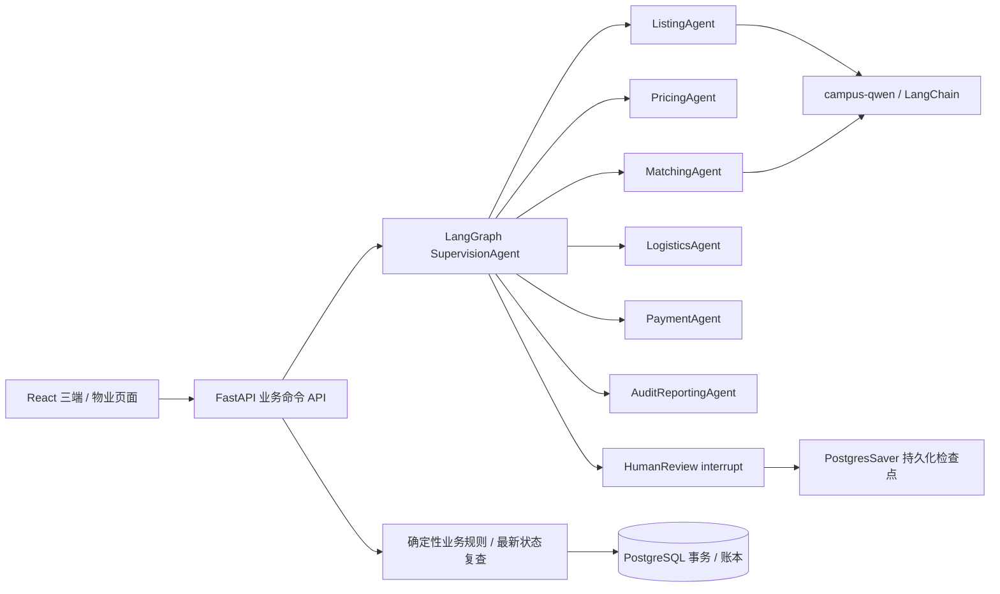

# Second Space：Python 后端实现说明

## 当前约定优先级

依据 `技术栈1.md` 实现；其中原始 Agent 规则若与用户后来确认的 MVP 不同，以当前前端为准。

- Python 3.12、FastAPI、psycopg、Google Cloud SQL for PostgreSQL。
- LangChain 工具与模型适配；LangGraph 负责 6 个业务节点 + SupervisionAgent。
- 唯一允许模型为 `campus-qwen`，Base URL 和 API key 由 `.env` 注入。
- 订单仅 pending / transit / received / settled。settled 在买家和卖家端映射为交易完成。
- 买家验收操作与模拟结算、留置解除、流水写入同一个 PostgreSQL 事务。
- 不添加争议等待期、待结算、退款或配送受阻状态。已有前端的交付问题标记和管理政策交互保留，不新增异常状态。
- 楼梯、电梯、底层使用同一门宽门高校验。原 MVP 不计算楼梯转弯几何。
- 固定价格：卖家服务费 2%，物流方服务费 10%；买家只支付商品和配送总价。

## 架构

所有节点会被实际图路由调用，决策被记录。监督节点按操作和现行政策调度；未满足政策的固定报价冲突进入 HumanReview。管理端提交理由后用 `Command(resume=...)` 恢复同一 thread，再形成受约束的政策版本。自由文本只是处理理由，不能变成绕过付款、物业、验收的可执行指令。

图节点输出建议，不直接写订单。执行结束后重新读取并锁定数据库状态、重新校验，避免模型运算期间其他请求改变商品可售状态。检查点与业务提交是两个事务；业务 requestId 收据和订单唯一约束保证恢复/重复提交不会重复产生支付或结算。尚未实现跨服务分布式事务或外部真实转账。

## 各节点实现边界

| 节点 | 当前实现 | 不声称实现 |
|---|---|---|
| ListingAgent | 字段规则；真实上传图通过 campus-qwen 做方向/描述/清晰度结构化审核；失败保留拒绝上架记录 | 外部所有权验证、安全认证；模型不可达时的真实图片审核 |
| PricingAgent | 仅卖家点击按钮后启动；实时查询匿名公开来源并保存证据，按材质、成色、年限、尺寸评分与折算，计算相似度加权中位数；保留链接与采集时间 | 无真实成交数据；未公开的参数不可推断；样本不足或服务失败不返回建议价 |
| MatchingAgent | campus-qwen 结构化偏好；确定性硬过滤与 60% 偏好评分，最多 3 件 | 模型修改预算/尺寸约束 |
| LogisticsAgent | 两个模拟服务商、免费取送地址分区定价、门尺寸、物业与承运检查、配送动作 | 实际承运商、邮件、复杂三维搬运规划 |
| PaymentAgent | 演示付款、原子账本与验收结算、幂等 | 银行验真、真实扣款/转账 |
| AuditReportingAgent | 查询窗口报告，汇总数据库订单与结算证据 | 用 LLM 推测收入或生成无依据经营数字 |
| SupervisionAgent | 图路由、规则核对、政策应用、人工中断和恢复 | 自主突破业务保护条件 |

图片来源为界面“使用演示照片”时，记录 `explicit_demo_photos`，不假称模型检测结果。`MODEL_MODE=fixture` 仅用于明确开启的演示/测试；默认 `live`。真实图片审核不可用时拒绝上架并说明原因。文本偏好模型不可用时使用原前端关键词规则，记录 `keyword_fallback`；管理员可见该依据。

## 数据设计

`listings / quotes / orders / policies / cases / audit_events` 各自存实体 JSONB，保留现有前端字段契约，避免为接入后端改变页面。ID 主键、订单状态 CHECK、订单家具与报价唯一索引在数据库中约束。`payments` 和 `settlements` 为独立关系型账本，金额使用整数分，服务费先按分四舍五入，净额由金额减去服务费，确保金额守恒；页面净额采用相同口径。订单外键和唯一约束防止重复。

`app_meta` 保存演示时钟、默认需求和集合排序。MVP 用该单行的 `FOR UPDATE` 锁串行化业务写入，适合五人演示负载；不是高吞吐设计。后续若扩大规模，应改为按商品/订单行锁和增量实体更新。

PostgresSaver 使用独立 checkpoint 表；每个冲突记录 graphThread，重建应用后仍可恢复。媒体原图与 JPEG 预览放在持久化目录/PVC，数据库保存引用。支持 JPEG、PNG、WebP、HEIC/HEIF，每张最多 15 MiB，最多正面/俯视/侧面各一张、两张细节。

## 接口和角色

- `GET /api/state`：三端共享数据库视图；物业 token 仅返回对应申请。
- `POST /api/actions`：`{operation,payload,requestId}`；不接受客户端整份状态覆盖。
- operation：listing、pricing、recommend、quote、purchase、advance、property、discard_quotes、conflict、policy、tick、reset。
- `GET /api/reports?start=YYYY-MM-DD&end=YYYY-MM-DD`：管理员窗口报告。
- `POST /api/media`：卖家文件上传；`GET /api/media/{id}.jpg`：预览。
- `GET /api/health`：数据库连通与已配置模型模式；不会把未验证模型说成可用。
- `/docs`：FastAPI OpenAPI 页面。

演示用 `X-Demo-Role` 表示角色，用户无需登录。此 header 可被手动切换，所以不是生产权限认证；部署限定本机演示。买家与卖家视图的事件 Agent 名称在服务端替换为“系统消息”，内部审计仅 manager 视图返回。物业链接使用随机高熵 token，可跨浏览器确认，页面每 2 秒/重新聚焦查询更新。

银行卡表单值不会发送到 API；purchase 只接受 quoteId 和 method，多余字段在进入图检查点前拒绝。`.env` 不进入 Git、镜像或前端打包。所有模型请求仅发向配置的 campus-qwen 服务，不调用其他模型。

## 保留原前端

原 `stage2/react-frontend` 未改动，新实现位于此仓库 `frontend/`。样式、路由、中英切换和表单保留；将状态操作替换为异步 API。报价回退清空、BPAY、上传方向、物业回传字段翻译、三端状态映射沿用原版本。

原浏览器 localStorage 与 IndexedDB 不自动导入共享数据库，避免无校验导入。新实现使用明确的 seed 数据；原演示数据仍在原浏览器/端口中。

## 照片审核与人工参与边界（2026-10-23）

ListingAgent 负责真实上传照片的自动审核；审核通过即上架，不经过 HumanReview 或管理员批准。审核失败由卖家修改资料后重新提交，模型调用失败也不转交人工审批。HumanReview 仅用于当前 conflict 政策缺口分支，不属于 listing 路由。测试覆盖不足不能被写成业务人工审核要求。其他人工操作见 [人工参与核查](HUMAN-INVOLVEMENT.md)。

## 手动外部比价（2026-10-23）

新业务参考价格为空，页面挂载、修改类别和提交上架不触发估价。`pricing` 接收家具资料 `form`；提交上架不再触发 PricingAgent；主动估价先由 ListingAgent 审核照片和类别，通过才进行外部比价。主动请求的来源、实际抓取记录与匹配结果随 command receipt 保存。详见 [公开比价说明](PUBLIC-PRICING.md)。

The live orchestration described above is superseded by the model-selected request-scoped tool workflow in [AGENT-TOOLS.md](AGENT-TOOLS.md) as of 2026-10-29. Fixture mode remains explicit and is never an automatic fallback.
